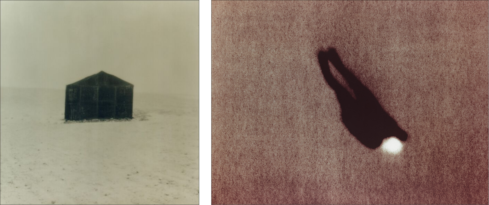

  
   
  
    Michal Rovner, <a href="https://www.metmuseum.org/art/collection/search/266682"><i>Outside #11</i></a> (1990–91), The Metropolitan Museum of Art (1992.5040)
    &middot;
    <a href="https://www.artnet.com/artists/michal-rovner/one-person-game-against-nature-9v-5GxdbC2HS588DzHCS7hR3w2"><i>One-Person Game Against Nature, #9V</i></a> (1993), Whitney Museum of American Art (2000.105)
    &middot;
    &copy; Michal Rovner.
  

