# Sub-Second `1,048,576`-Byte H-Net Pretraining Rounds on Apple M4 with Derivative-Free `operator-bo`

## 1. Executive Summary and Architecture Decision Matrix

**Bottom Line Up Front:** Evaluating an exact, continuous `1,048,576`-byte ($2^{20}$) native pretraining objective in under `1,000 ms` per complete `operator-bo` round on an Apple M4 (`10`-core GPU, `120 GB/s` unified memory bus, `20 GiB` sandbox USS cap) is **mathematically impossible** under the current [`fbt-pisa1-hnet-mhc4-v1`](file:///Users/mehulbafna/research/baux-hnet/rust/crates/baux/src/fbt_moe/architecture.rs#L112-L197) implementation. Code inspection and hardware arithmetic demonstrate four hard bottlenecks in the existing implementation:

1. **Hard Context Rejections and Uncompacted Core Dispatch:** [`validate_hnet`](file:///Users/mehulbafna/research/baux-hnet/rust/crates/baux/src/config/validation.rs#L133-L141), [`Scorer::hnet_chunk`](file:///Users/mehulbafna/research/baux-hnet/rust/crates/baux/src/fbt_scorer/mhc.rs#L156-L158), and [`fbt_block/batch.rs`](file:///Users/mehulbafna/research/baux-hnet/rust/crates/baux/src/fbt_block/batch.rs#L272-L276) reject any sequence with `tokens > 4096`. Furthermore, [`hnet_mhc_chunk`](file:///Users/mehulbafna/research/baux-hnet/rust/crates/baux/src/hnet/bridge.metal#L46-L71) zero-pads the 4 mHC streams from the active chunk count $C$ back to the full capacity $L$ and leaves `self.active_rows` equal to $L$ ([`mhc.rs`](file:///Users/mehulbafna/research/baux-hnet/rust/crates/baux/src/fbt_scorer/mhc.rs#L208-L210)). Running all 7 recurrent layer executions at $L = 1,048,576$ requires **$42.92\text{ TFLOPs}$** per candidate forward pass—consuming **$2,960\text{ ms}$** at the theoretical `14.5 TFLOPS` peak of the M4 GPU and **`5,723 ms`** at realistic sustained throughput (`7.5 TFLOPS`).
2. **Late Byte-Level Core Visits (`execution == 0` and `execution == 6`):** In [`fbt_scorer.rs`](file:///Users/mehulbafna/research/baux-hnet/rust/crates/baux/src/fbt_scorer.rs#L592-L611), `execution == 0` (Layer 0, pass 0) runs at full byte length $L$ before [`hnet_chunk`](file:///Users/mehulbafna/research/baux-hnet/rust/crates/baux/src/fbt_scorer/mhc.rs#L155-L212) is called, and `execution == 6` (Layer 4, pass 1) runs at full byte length $L$ after [`hnet_dechunk`](file:///Users/mehulbafna/research/baux-hnet/rust/crates/baux/src/fbt_scorer/mhc.rs#L214-L254) is called. Each full visit of a $D = 512$, 4-stream mHC, PISA-1 attention, and 626-expert Top-3+1 MoE layer costs $5.793\text{M FLOPs/row}$. Running just those two visits at $L = 1,048,576$ rows requires **$12.15\text{ TFLOPs}$** (`> 1,620 ms` at `7.5 TFLOPS`) before any chunked core layer executes.
3. **Repeated MoE Weight Streaming Under Naive Window Tiling:** The 5-layer MoE stack holds `1,043,504,920` parameters (`2.087 GB` in FP16). Under `Mhc4` long-context evaluation ([`long.rs`](file:///Users/mehulbafna/research/baux-hnet/rust/crates/baux/src/fbt_moe/long.rs#L14-L53)), a `1,048,576`-token window is split into `128` sequential tiles of `ROWS = 8,192` ([`buffers.rs`](file:///Users/mehulbafna/research/baux-hnet/rust/crates/baux/src/fbt_moe/buffers.rs#L266-L277)). Because `3` routed experts are selected per token out of `625`, a tile of $M \ge 1,024$ tokens touches $1 - (622/625)^{1024} = 99.27\%$ of all expert weights. Streaming `2.087 GB` of weights from DRAM across `128` sequential tiles transfers **$267.1\text{ GB}$** of weights, requiring **`2,428 ms`** at `110 GB/s` effective DRAM bandwidth.
4. **Single-Threadgroup Scalar Bridge Kernels and Unbounded Scratch:** [`hnet/bridge.metal`](file:///Users/mehulbafna/research/baux-hnet/rust/crates/baux/src/hnet/bridge.metal) executes [`hnet_mhc_chunk`](file:///Users/mehulbafna/research/baux-hnet/rust/crates/baux/src/hnet/bridge.metal#L46-L71) on a single thread (`tid == 0`) over $L$ steps, executes [`hnet_mhc_dechunk`](file:///Users/mehulbafna/research/baux-hnet/rust/crates/baux/src/hnet/bridge.metal#L73-L98) on 512 threads looping serially over $C$ and $L$, and computes [`hnet_mhc_project`](file:///Users/mehulbafna/research/baux-hnet/rust/crates/baux/src/hnet/bridge.metal#L3-L23) and [`hnet_mhc_readout`](file:///Users/mehulbafna/research/baux-hnet/rust/crates/baux/src/hnet/bridge.metal#L101-L135) via scalar loops without `simdgroup_matrix` TensorOps. Meanwhile, allocating full-window `[1048576, 4, 512]` FP16 activation buffers (`4.194 GB` each) across [`Buffers`](file:///Users/mehulbafna/research/baux-hnet/rust/crates/baux/src/fbt_moe/buffers.rs#L124-L280) requires **$> 29\text{ GiB}$**, exceeding the `20 GiB` sandbox memory ceiling.

### Summary Comparison of Architectural Regimes at $L = 1,048,576$ Bytes on Apple M4

| Regime | Byte / Subchunk Encoder | Core Visits & Sequence Length | Total Round FLOPs | Total Round DRAM Traffic | Peak Working Set (USS) | Estimated M4 Round Time (`p50`) | Meets `< 1,000 ms` & `< 20 GiB`? |
| :--- | :--- | :--- | :---: | :---: | :---: | :---: | :---: |
| **A. Current `fbt-pisa1-hnet-mhc4-v1` (Uncompacted)** | Visit 0 (Full PISA/mHC/MoE at $L=1\text{M}$) | Visits 1–6 at $L=1,048,576$ (zero-padded) | `42.92 TFLOPs` | `> 180 GB` | `> 29.4 GiB` (OOM) | `~6,850 ms` | **No** (Compute, BW, & RAM fail) |
| **B. Current 1-Stage + Active-Row Compaction ($N=4$, Tiled 128$\times$8K)** | Visit 0 at $L=1\text{M}$; Visit 6 at $L=1\text{M}$ | Visits 1–5 at $C = 262,144$ across 128 tiles | `21.28 TFLOPs` | `~312 GB` (MoE re-read 128$\times$) | `~4.8 GiB` | `~5,260 ms` | **No** (Visit 0/6 FLOPs & 128$\times$ MoE BW fail) |
| **C. Early 1-Stage H-Net ($N=8$, Stage-Sync Core)** | Lightweight Stage-0 ($d_0=256$) at $L=1\text{M}$ | All 7 visits at $C = 131,072$ (1 macro-pass) | `7.18 TFLOPs` | `~18.4 GB` | `~6.4 GiB` | `~1,040 ms` | **Borderline** (`p95 > 1,150 ms`) |
| **D. Proposed 2-Stage H-Net ($N_0=4, N_1=4 \implies N=16$, Stage-Sync Core + Fused `operator-bo`)** | Tiled Stage-0 ($d_0=128$) at $L=1\text{M}$ $\to$ Stage-1 ($d_1=256$) at $L_1=262\text{K}$ | All 7 visits at $C = 65,536$ ($D=512$, 1 macro-pass) | **`4.48 TFLOPs`** | **`~11.6 GB`** | **`~5.1 GiB`** | **`~665 ms`** (`p95 ~840 ms`) | **Yes** (Proven feasible with 33% margin) |

---

## 2. Hardware Baseline: Apple M4 Compute, Bandwidth, and Residency Budgets

### 2.1 Measured Host Specifications

Direct inspection of the target machine via `sysctl` and `system_profiler SPDisplaysDataType` establishes the following hardware parameters (Evidence Log, Hypothesis 1):

- **SoC**: Apple M4 (`Mac16,10`, `arm64e`).
- **CPU**: 10 cores total — 4 Performance cores (`128 KB` L1I, `64 KB` L1D, `16 MB` shared L2 cache) and 6 Efficiency cores (`128 KB` L1I, `64 KB` L1D, `4 MB` shared L2 cache), matrix coprocessor (`hw.optional.arm.FEAT_SME = 1`, `FEAT_SME2 = 1`, `FEAT_BF16 = 1`, `FEAT_FP16 = 1`).
- **GPU**: Apple M4 10-core integrated GPU supporting **Metal 4** (`MTLGPUFamilyApple9`), 128 execution units / 1,280 ALUs, 32-lane SIMD groups (`simdgroup_matrix<half, 8, 8>`).
- **Unified Memory Capacity**: `24 GiB` physical LPDDR5X-7500 (`25,769,803,776` bytes), with a strict Malvin sandbox USS limit of **`20.0 GiB`** (`21,474,836,480` bytes).
- **Unified Memory Bandwidth**: Dual 32-bit LPDDR5X-7500 channels providing **`120.0 GB/s`** theoretical peak bandwidth and **`100.0–112.0 GB/s`** maximum sustained bandwidth under Metal compute command encoders.

### 2.2 Concrete Per-Round Budget for Sub-Second (`< 1,000 ms`) Execution

Let $T_{\text{round}}$ denote the complete wall-clock duration of one `operator-bo` optimization round over a contiguous `1,048,576`-byte training window, encompassing:
1. `operator-bo` surrogate coordinate sampling, distance evaluation, and acquisition selection (`sample_distances` + `select_from_pool`).
2. Candidate parameter preparation (`materialize_selection` or fused on-the-fly perturbation).
3. Full `1,048,576`-byte forward evaluation and exact cross-entropy + ratio-loss reduction (`eval_hnet_round`).
4. `operator-bo` observation recording, trust/reliability update, and conditional weight commit (`tell_noisy` / `tell_evaluated`).

 under the roof-line model on Apple M4:
$$\text{Peak FP16 Matrix Throughput} = 10\text{ cores} \times 128\text{ ALUs/core} \times 8\text{ FP16 MACs/ALU-cycle (TensorOps)} \times 1.45\text{ GHz} \approx 14.8\text{ TFLOPS}.$$
For mixed workloads combining `simdgroup_matrix` GEMMs, sparse 626-expert MoE gather/scatter, PISA-1 block-sparse attention, and reductions, sustained GPU throughput $\mathcal{C}_{\text{sust}}$ lies in **`6.5–8.5 TFLOPS`** (with `7.5 TFLOPS` as the central design point), and sustained unified memory bandwidth $\mathcal{B}_{\text{sust}}$ outside SLC cache hits is **`105 GB/s`**.

To guarantee $T_{\text{round}} < 1,000\text{ ms}$ at `p95` (targeting `p50 <= 680 ms`, `p95 <= 880 ms` to leave a `120–320 ms` safety margin for OS/driver jitter and command-buffer transitions), the complete round must obey three hard budgets:

$$\boxed{\begin{aligned}
\text{Compute Budget:} &\quad \mathcal{F}_{\text{round}} \le 5.2\text{ TFLOPs} \quad (\text{at } 7.5\text{ TFLOPS sustained} \implies \le 693\text{ ms compute}), \\
\text{DRAM Bandwidth Budget:} &\quad \mathcal{M}_{\text{DRAM, round}} \le 18.0\text{ GB} \quad (\text{at } 105\text{ GB/s sustained} \implies \le 171\text{ ms non-overlapped DRAM}), \\
\text{Memory Residency Budget:} &\quad \text{USS}_{\text{peak}} \le 16.0\text{ GiB} \quad (\text{leaving } 4.0\text{ GiB headroom below the } 20.0\text{ GiB sandbox kill limit}).
\end{aligned}}$$

---

## 3. Audit of the Current Baux H-Net Implementation and Exact Arithmetic

### 3.1 Canonical Shapes and Parameter Accounting

From [`rust/crates/baux/semantics/src/shape.rs`](file:///Users/mehulbafna/research/baux-hnet/rust/crates/baux/semantics/src/shape.rs#L8-L35), [`rust/crates/baux/semantics/src/mhc4.rs`](file:///Users/mehulbafna/research/baux-hnet/rust/crates/baux/semantics/src/mhc4.rs#L9-L18), and [`rust/crates/baux/src/fbt_moe/architecture.rs`](file:///Users/mehulbafna/research/baux-hnet/rust/crates/baux/src/fbt_moe/architecture.rs#L112-L197), the canonical `fbt-pisa1-hnet-mhc4-v1` (`ResidualArchitecture::HnetMhc4`) dimensions are:

- **Model Width ($D$)**: `WIDTH = 512`.
- **Manifold-Constrained Hyper-Connections (`mHC-4`)**: `MHC4_STREAMS = 4` parallel residual streams of width `512` (`MHC_INPUT = 2,048`, `MHC_COEFS = 24` per mixing site: $4 \times 4$ doubly-stochastic Sinkhorn matrix $H^{\text{res}}$, 4 pre-mix weights $H^{\text{pre}}$, and 4 post-mix weights $H^{\text{post}}$).
- **Physical Layers vs. Recurrent Visits**: `MHC4_LAYERS = 5` physical parameter layers executed across `7` recurrent layer steps `[0, 1, 2, 1, 2, 3, 4]` (`executions = 0..=6` in [`ResidualArchitecture::layer_steps`](file:///Users/mehulbafna/research/baux-hnet/rust/crates/baux/src/fbt_moe/architecture.rs#L121-L133)).
- **PISA-1 Attention**: `QUERY_HEADS = 8`, `KV_HEADS = 1` (MQA), `HEAD_DIM = 64`, `QKV_WIDTH = 640` ($512 + 64 + 64$). Block size `BLOCK = 64`, `SELECTED = 8` blocks ($8 \times 64 = 512$ keys attended per query row), query tile $= 4$.
- **Sparse MoE per Layer**: `ROUTED_COUNT = 625` routed experts + `SHARED_COUNT = 1` shared expert = `626` experts (`MOE_EXPERTS`). Each token activates `ACTIVE_COUNT = 4` experts (`1` shared + `3` routed via product-key / top-$k$ router). Each expert has `EXPERT_WIDTH = 216` and SwiGLU `GATE_WIDTH = 432`.
- **H-Net Dynamic Chunking Bridge**: `HNET_PROJECTIONS = 3` matrices ($W_q, W_k, W_{\text{res}} \in \mathbb{R}^{512 \times 512}$) plus residual bias $b_{\text{res}} \in \mathbb{R}^{512}$ (`HNET_PARAMS = 786,944` parameters), and byte vocabulary `HNET_VOCAB = 256` (`HNET_READOUT = 512 * 256 = 131,072` parameters).

#### Exact Parameter Breakdown (`ResidualArchitecture::HnetMhc4::parameter_count()`)

| Component | Shape / Formula | Parameter Count | FP16 Size (MB) |
| :--- | :--- | ---: | ---: |
| **Per-Layer Attention** ($\times 5$) | $W_{\text{qkv}} (512 \times 640) + W_o (512 \times 512)$ | `2,949,120` | `5.90 MB` |
| **Per-Layer MoE Router** ($\times 5$) | $W_{\text{router}} (512 \times 625)$ | `1,600,000` | `3.20 MB` |
| **Per-Layer MoE Experts** ($\times 5$) | $626 \times (W_{\text{gate\_up}} [512 \times 432] + W_{\text{down}} [216 \times 512])$ | `1,038,458,880` | `2,076.92 MB` |
| **Per-Layer RMSNorms & mHC-4** ($\times 5$) | $2 \times 512 + 2 \times (2048 \times 24 + 24 + 4)$ | `496,920` | `0.99 MB` |
| **H-Net Bridge (`hnet`)** | $W_q, W_k, W_{\text{res}} (3 \times 512^2) + b_{\text{res}} (512)$ | `786,944` | `1.57 MB` |
| **Final Norm + Byte Readout** | $\text{norm} (512) + \text{readout} (512 \times 256)$ | `131,584` | `0.26 MB` |
| **Total (`fbt-pisa1-hnet-mhc4-v1`)** | Matches [`architecture.rs:145-161`](file:///Users/mehulbafna/research/baux-hnet/rust/crates/baux/src/fbt_moe/architecture.rs#L145-L161) | **`1,044,423,448`** | **`2,088.85 MB`** |

*(Notice that `99.43%` of all parameters—`1,038.46M` out of `1,044.42M`—reside in the 5-layer MoE expert banks.)*

### 3.2 Per-Row FLOP Accounting for One Core Layer Visit

For a sequence of $R$ active rows entering one visit of the PISA-1 / mHC-4 / MoE core ([`fbt_scorer.rs:584-621`](file:///Users/mehulbafna/research/baux-hnet/rust/crates/baux/src/fbt_scorer.rs#L584-L621)), the exact floating-point operation count per row ($1\text{ MAC} = 2\text{ FLOPs}$) is:

1. **Attention-Site mHC-4 (`encode_mhc_pre` + `encode_mhc_post`)**:
   - Flatten 4 streams ($2048$), RMSNorm, linear projection $2048 \to 24$ ($2 \times 2048 \times 24 = 98,304\text{ FLOPs}$), 20-step $4 \times 4$ Sinkhorn-Knopp normalization, and stream combination ($4 \times 4 \times 512 \times 2 = 16,384\text{ FLOPs}$): **`122,880 FLOPs/row`**.
2. **Attention QKV and Output Projections (`encode_attention`)**:
   - On anchor visits (where `csa_reuse == false`): $W_{\text{qkv}}$ ($2 \times 512 \times 640 = 655,360\text{ FLOPs}$) + $W_o$ ($2 \times 512 \times 512 = 524,288\text{ FLOPs}$) = **`1,179,648 FLOPs/row`**.
   - On CSA-reused visits (`csa_reuse == true`, which in [`fbt_scorer.rs:698-702`](file:///Users/mehulbafna/research/baux-hnet/rust/crates/baux/src/fbt_scorer.rs#L698-L702) is only `execution == 3 | 5` for `HnetMhc4`): $W_{\text{qkv}}$ is skipped; only $W_o$ runs = **`524,288 FLOPs/row`**.
3. **PISA-1 Sparse Attention (`fbt_pisa1.rs`)**:
   - Each query row has $H_q = 8$ heads of dimension $d_h = 64$ attending to `SELECTED = 8` blocks of `BLOCK = 64` keys ($K_{\text{sel}} = 512$ keys):
     $$\text{Score} + \text{Value Aggregation} = 2 \times H_q \times K_{\text{sel}} \times d_h + 2 \times H_q \times K_{\text{sel}} \times d_h = 4 \times 8 \times 512 \times 64 = 1,048,576\text{ FLOPs/row}.$$
   - Including hierarchical binary-tree summary construction and coarse block selection ($\approx 73,728\text{ FLOPs/row}$ on anchor visits), PISA-1 costs **`1,122,304 FLOPs/row`** on anchor visits and **`1,048,576 FLOPs/row`** on CSA-reused visits.
4. **MoE-Site mHC-4 (`encode_mhc_pre` + `encode_mhc_post`)**: **`122,880 FLOPs/row`**.
5. **MoE Router + 4 Active Experts (`encode_moe`)**:
   - Router GEMM ($512 \to 625$): $2 \times 512 \times 625 = 640,000\text{ FLOPs/row}$.
   - `1` shared expert + `3` routed experts (`4` active experts total), each computing `gate_up` ($512 \to 432$) and `down` ($216 \to 512$):
     $$4 \times \left(2 \times 512 \times 432 + 2 \times 216 \times 512\right) = 4 \times (442,368 + 221,184) = 2,654,208\text{ FLOPs/row}.$$
   - Total MoE per row = **`3,294,208 FLOPs/row`**.

Summing all terms yields the exact per-row cost of a core layer visit:
$$\boxed{\begin{aligned}
\text{Anchor Core Visit (`csa_reuse = false`):} &\quad \mathbf{5,841,920\text{ FLOPs/row}}, \\
\text{CSA-Reused Core Visit (`csa_reuse = true`):} &\quad \mathbf{5,112,832\text{ FLOPs/row}}.
\end{aligned}}$$

### 3.3 Why the Current H-Net Implementation Fails at $L = 1,048,576$ (Four Impossibility Proofs)

#### Impossibility Proof 1: Uncompacted Core Execution (`active_rows == L` in [`mhc.rs:208-210`](file:///Users/mehulbafna/research/baux-hnet/rust/crates/baux/src/fbt_scorer/mhc.rs#L208-L210))

In the current codebase, [`Scorer::hnet_chunk`](file:///Users/mehulbafna/research/baux-hnet/rust/crates/baux/src/fbt_scorer/mhc.rs#L155-L212) dispatches [`hnet_mhc_project`](file:///Users/mehulbafna/research/baux-hnet/rust/crates/baux/src/hnet/bridge.metal#L3-L23) ($3 \times 2 \times 512^2 = 1,572,864\text{ FLOPs/row}$), [`hnet_mhc_boundary`](file:///Users/mehulbafna/research/baux-hnet/rust/crates/baux/src/hnet/bridge.metal#L25-L44), and [`hnet_mhc_chunk`](file:///Users/mehulbafna/research/baux-hnet/rust/crates/baux/src/hnet/bridge.metal#L46-L71), which pads rows `count[0]..L` with zeros and keeps `self.active_rows = L`. Across all 7 visits (`5` anchor visits `0, 1, 2, 4, 6` and `2` CSA-reused visits `3, 5`) plus H-Net projections and byte readout ($2 \times 512 \times 256 = 262,144\text{ FLOPs/row}$):
$$\mathcal{F}_{\text{uncompacted}}(L) = L \times \left(5 \times 5,841,920 + 2 \times 5,112,832 + 1,572,864 + 262,144\right) = L \times 41,270,272\text{ FLOPs}.$$
At $L = 1,048,576$:
$$\mathcal{F}_{\text{uncompacted}}(1,048,576) = \mathbf{43.275\text{ TFLOPs}}.$$
Even at the theoretical `14.8 TFLOPS` hardware ceiling of the Apple M4 GPU, `43.275 TFLOPs` requires **`2,924 ms`**; at a realistic `7.5 TFLOPS`, compute alone takes **`5,770 ms`** ($5.77\times$ over the 1,000 ms budget).

#### Impossibility Proof 2: Late Compaction (`execution == 0` and `execution == 6` at Full Byte Resolution)

Suppose we fix [`mhc.rs`](file:///Users/mehulbafna/research/baux-hnet/rust/crates/baux/src/fbt_scorer/mhc.rs#L208-L210) so that `self.active_rows` is compacted to $C = L / 4 = 262,144$ for the 5 middle visits (`execution = 1..=5`), while retaining the current [`fbt_scorer.rs:592-611`](file:///Users/mehulbafna/research/baux-hnet/rust/crates/baux/src/fbt_scorer.rs#L592-L611) placement where `execution == 0` (pre-chunk) and `execution == 6` (post-dechunk) run at full byte resolution $L = 1,048,576$:
$$\begin{aligned}
\mathcal{F}_{\text{visit 0 + visit 6}} &= 2 \times 1,048,576 \times 5,841,920 = \mathbf{12.252\text{ TFLOPs}}, \\
\mathcal{F}_{\text{bridge + readout}} &= 1,048,576 \times (1,572,864 + 262,144) = \mathbf{1.924\text{ TFLOPs}}, \\
\mathcal{F}_{\text{visits 1..5}}(C = 262,144) &= 262,144 \times (3 \times 5,841,920 + 2 \times 5,112,832) = \mathbf{7.275\text{ TFLOPs}}, \\
\mathcal{F}_{\text{total, late-compacted}} &= \mathbf{21.451\text{ TFLOPs}}.
\end{aligned}$$
Even with perfect `4x` compaction inside the middle 5 visits, the two uncompacted byte-level visits (`execution == 0` and `execution == 6`) plus the middle visits require **`21.451 TFLOPs`**, which takes **`2,860 ms`** of compute time at `7.5 TFLOPS` (nearly $3\times$ over the 1,000 ms budget). **Corollary:** *No architecture that executes even a single full $D = 512$, 626-expert MoE + PISA-1 layer visit at raw byte resolution $L = 1,048,576$ can finish a complete round in under 1,000 ms on Apple M4.*

#### Impossibility Proof 3: Sequential Tile Streaming of Sparse MoE Weights

Suppose we tile the $1,048,576$-byte window into $K_{\text{tiles}} = 128$ sequential tiles of `8,192` bytes (matching [`long.rs`](file:///Users/mehulbafna/research/baux-hnet/rust/crates/baux/src/fbt_moe/long.rs#L14-L53)) and run the 5-layer MoE stack on each tile in sequence. Each physical layer contains $E = 625$ routed experts of size $2 \times (512 \times 432 + 216 \times 512) = 663,552\text{ bytes}$ (`0.6636 MB`) each. If a tile has $M$ active chunks and each chunk routes to $k = 3$ distinct experts, the expected fraction of routed experts touched in that tile under balanced routing (enforced by the H-Net ratio loss and load balancing) is:
$$f_{\text{touched}}(M) = 1 - \left(1 - \frac{3}{625}\right)^M.$$
- For $M = 2,048$ chunks ($4\times$ compression on an 8,192-byte tile): $f_{\text{touched}}(2048) = 1 - (0.9952)^{2048} = 99.995\%$.
- Even for $M = 512$ chunks ($16\times$ compression on an 8,192-byte tile): $f_{\text{touched}}(512) = 1 - (0.9952)^{512} = 91.48\%$.

Because the `2.087 GB` MoE weight bank exceeds the M4 GPU L2/SLC cache (`16–24 MB`), running all 5 MoE layers tile-by-tile across `128` sequential tiles forces the GPU to stream $\ge 0.915 \times 2.087\text{ GB} = 1.91\text{ GB}$ of expert weights from unified DRAM **on every tile**:
$$\mathcal{M}_{\text{MoE weights, 128 tiles}} = 128 \times 1.91\text{ GB} = \mathbf{244.5\text{ GB}} \implies \frac{244.5\text{ GB}}{105\text{ GB/s}} = \mathbf{2,328\text{ ms}}\text{ (DRAM bandwidth bound alone)}.$$
**Corollary:** *The heavy MoE core cannot be executed inside an outer loop over 128 small sequence tiles. Early stages must first compress and pack the entire 1,048,576-byte window into a compact sequence of $C$ chunks so that the 5-layer MoE core executes in a single stage-synchronous pass (reading the `2.087 GB` expert weights from DRAM only once per round, taking `~19.9 ms`).*

#### Impossibility Proof 4: Unshared Multi-Candidate Full-Weight Materialization and Full-Window Scratch

1. **Full-Window Scratch OOM**: In [`buffers.rs:124-143`](file:///Users/mehulbafna/research/baux-hnet/rust/crates/baux/src/fbt_moe/buffers.rs#L124-L143), `HnetScratch::allocate` allocates `pre_streams [4 * L * D]`, `routed [L * D]`, `residual [L * D]`, `keys [L * D]`, `probs [L]` (FP32), `origins [L]` (u32), and `plug [L]` (u32), while `Buffers::for_context` allocates `streams`, `work`, `norm`, `attn_out`, `moe_out`, `qkv`, and `logits`. At $L = 1,048,576$ and $D = 512$:
   - Each 4-stream FP16 buffer (`streams`, `work`, `pre_streams`) is $1,048,576 \times 4 \times 512 \times 2 = \mathbf{4.295\text{ GB}}$ (`4.00 GiB`).
   - Six single-stream FP16 buffers (`norm`, `attn_out`, `moe_out`, `routed`, `residual`, `keys`) + `qkv` (`640`) + `logits` (`256`) total $\mathbf{7.78\text{ GB}}$ (`7.25 GiB`).
   - Together with `SearchState` (`base`, `proposal`, `reference`, `history_rows` $\approx 8.4\text{ GiB}$), full-window allocation exceeds **`27.6 GiB`**, triggering an immediate sandbox kill (`> 20.0 GiB`).
2. **Multi-Candidate Weight Materialization**: If an optimizer materializes and evaluates $K = 4$ independent full-model weight buffers (`4 x 2.089 GB`) per round without coordinate sampling or base-weight sharing, materializing and reading those weights adds $4 \times (4.18\text{ GB materialize} + 2.09\text{ GB read}) = 25.1\text{ GB}$ (`~240 ms`) of pure weight-copy overhead and `8.36 GB` of extra residency.

---

## 4. Required Architecture and Metal 4 Kernel Redesign

To satisfy all three Apple M4 budgets ($\mathcal{F}_{\text{round}} \le 5.2\text{ TFLOPs}$, $\mathcal{M}_{\text{DRAM}} \le 18.0\text{ GB}$, $\text{USS}_{\text{peak}} \le 16.0\text{ GiB}$) while preserving an **exact, continuous `1,048,576`-byte autoregressive objective on every round**, Baux must transition from the current late-compacted 1-stage bridge (`fbt-pisa1-hnet-mhc4-v1`) to a **2-Stage Early-Compressed Hierarchical H-Net (`fbt-pisa1-hnet2-mhc4-v2`)** with four co-designed Metal 4 kernel subsystems.

```mermaid
flowchart LR
    subgraph S0["Stage 0: Tiled Byte Encoder (L = 1,048,576, d0 = 128)"]
        B["Raw Bytes [1,048,576]<br/>Tiled in 64 x 16,384-byte SRAM tiles"] --> E0["Causal Conv-4 + Gated Linear<br/>+ Boundary Router (N0 = 4)"]
        E0 --> P0["Multi-TG Prefix-Sum Compaction<br/>into Subchunk Buffer [L1 ~ 262,144, d1 = 256]"]
    end
    subgraph S1["Stage 1: Subchunk Encoder (L1 ~ 262,144, d1 = 256)"]
        P0 --> E1["2-Layer Local Block-PISA / SSM<br/>+ Boundary Router (N1 = 4)"]
        E1 --> P1["Multi-TG Prefix-Sum Compaction<br/>into Chunk mHC-4 Streams [L2 ~ 65,536, 4, 512]"]
    end
    subgraph CORE["Stage 2: Compact PISA-1 + mHC-4 + 626-Expert MoE Core"]
        P1 --> C7["All 7 Recurrent Visits [0,1,2,1,2,3,4]<br/>at C = L2 ~ 65,536 rows (D = 512)<br/>MoE weights (2.09 GB) streamed ONCE"]
    end
    subgraph DEC["Hierarchical Associative Dechunk + Fused Tiled Readout"]
        C7 --> D1["O(log L2) Associative Scan EMA Dechunk<br/>+ Stage-1 Local Decoder [L1 ~ 262,144, d1 = 256]"]
        D1 --> D0["O(log L1) Associative Scan EMA Dechunk<br/>+ Tiled 16K SRAM Plug-Back + STE + Byte Readout (256)<br/>+ Online Log-Sum-Exp Loss Reduction"]
    end
```

---

### 4.1 Subsystem 1: Early Learned Hierarchical Compression Before the PISA/mHC Core

Following the 2-stage H-Net formulation of Hwang, Wang, & Gu (2025, [arXiv:2507.07955](https://arxiv.org/abs/2507.07955), reflected in the upstream reference [`.cache/baux/upstream/hnet/configs/hnet_2stage_L.json`](file:///Users/mehulbafna/research/baux-hnet/.cache/baux/upstream/hnet/configs/hnet_2stage_L.json) and [`hnet/models/hnet.py`](file:///Users/mehulbafna/research/baux-hnet/.cache/baux/upstream/hnet/hnet/models/hnet.py#L46-L240)), raw bytes should **never** enter a $D = 512$, 626-expert MoE layer directly. Instead, progressive dimension expansion ($d_0 = 128 \to d_1 = 256 \to D = 512$) and two learned dynamic chunking stages compress the sequence by $N_{\text{total}} = N_0 \times N_1 = 4 \times 4 = 16\times$ before `execution == 0` of the PISA-1 / mHC-4 / MoE core:

1. **Stage 0 (Byte Level, $L_0 = 1,048,576$, width $d_0 = 128$, target ratio $N_0 = 4$)**:
   - **Architecture**: Byte embedding table $E_{\text{byte}} \in \mathbb{R}^{256 \times 128}$ followed by 2 lightweight causal depthwise-separable conv-4 + SwiGLU gated linear blocks ($d_0 = 128$, hidden $256$).
   - **Why Conv/Local SSM at Stage 0**: Hwang et al. ([arXiv:2507.07955](https://arxiv.org/abs/2507.07955), Section 3.3) demonstrate that lightweight state-space / causal convolution encoders at the raw byte level outperform isotropic self-attention for boundary detection while requiring $O(L_0 d_0^2)$ compute and only a 3-element causal recurrent state across tile boundaries.
   - **Stage-0 Dynamic Chunking**: Projects $q_t^{(0)} = W_q^{(0)} \hat{x}_t^{(0)}, k_t^{(0)} = W_k^{(0)} \hat{x}_t^{(0)} \in \mathbb{R}^{128}$, computes boundary probability
     $$p_t^{(0)} = \frac{1}{2}\left(1 - \frac{\langle q_t^{(0)}, k_{t-1}^{(0)} \rangle}{\|q_t^{(0)}\|_2 \|k_{t-1}^{(0)}\|_2}\right), \quad b_t^{(0)} = \mathbb{I}\!\left[p_t^{(0)} \ge 0.5\right] \quad \left(p_0^{(0)} = 1, b_0^{(0)} = 1\right),$$
     selects boundary vectors where $b_t^{(0)} = 1$, and linearly projects selected vectors from $d_0 = 128 \to d_1 = 256$.
   - **Stage-0 FLOPs per byte**:
     - Two conv-4 + gated linear blocks: $2 \times \left(2 \times 4 \times 128 + 2 \times (128 \times 512 + 256 \times 128)\right) = 395,264\text{ FLOPs/byte}$.
     - Stage-0 router ($W_q^{(0)}, W_k^{(0)} \in \mathbb{R}^{128 \times 128}$): $2 \times 2 \times 128^2 = 65,536\text{ FLOPs/byte}$.
     - Total Stage-0 Encoder + Router = **`460,800 FLOPs/byte`** $\implies \mathbf{0.483\text{ TFLOPs}}$ across all $1,048,576$ bytes.

2. **Stage 1 (Subchunk Level, $L_1 \approx L_0 / 4 = 262,144$, width $d_1 = 256$, target ratio $N_1 = 4$)**:
   - **Architecture**: 2 local block-causal mixer layers at width $d_1 = 256$ (window size $W = 64$, $H = 4$ heads of $d_h = 64$, plus SwiGLU MLP $256 \to 512 \to 256$).
   - **Stage-1 Dynamic Chunking**: Projects $q_u^{(1)}, k_u^{(1)} \in \mathbb{R}^{256}$, computes $p_u^{(1)}, b_u^{(1)} = \mathbb{I}[p_u^{(1)} \ge 0.5]$, compacts active chunks to $L_2 \approx L_1 / 4 = 65,536$, and projects $d_1 = 256 \to D = 512$ to initialize the 4 mHC-4 streams (`streams[0..4]`) for the core.
   - **Stage-1 FLOPs per subchunk**:
     - Up-projection $128 \to 256$: $65,536\text{ FLOPs/subchunk}$.
     - Two local attention + MLP layers: $2 \times \left(4 \times 256^2 + 4 \times 256 \times 64 + 2 \times 2 \times 256 \times 512\right) = 1,703,936\text{ FLOPs/subchunk}$.
     - Stage-1 router ($W_q^{(1)}, W_k^{(1)} \in \mathbb{R}^{256 \times 256}$): $2 \times 2 \times 256^2 = 262,144\text{ FLOPs/subchunk}$.
     - Total Stage-1 Encoder + Router = **`2,031,616 FLOPs/subchunk`** $\implies \mathbf{0.533\text{ TFLOPs}}$ at $L_1 = 262,144$.

3. **Stage 2 (7-Visit PISA-1 / mHC-4 / 626-Expert MoE Core at $L_2 \approx 65,536$, width $D = 512$)**:
   - Because all 7 recurrent visits (`[0, 1, 2, 1, 2, 3, 4]`) now execute inside the compressed latent space of $C = L_2 \approx 65,536$ chunks (with CSA reuse active on visits `1, 3, 5, 6`, since all 7 visits share the identical chunk coordinate frame!):
     - 3 anchor visits (`0, 2, 4`): $3 \times 5,841,920 = 17,525,760\text{ FLOPs/chunk}$.
     - 4 CSA-reused visits (`1, 3, 5, 6`): $4 \times 5,112,832 = 20,451,328\text{ FLOPs/chunk}$.
     - Up/down stream projections ($256 \leftrightarrow 512$): $524,288\text{ FLOPs/chunk}$.
     - Total Core per chunk = **`38,501,376 FLOPs/chunk`**.
   - At $C = 65,536$ chunks ($N_{\text{total}} = 16\times$), the entire 7-visit PISA-1 / mHC-4 / MoE core requires:
     $$\mathcal{F}_{\text{core}}(65,536) = 65,536 \times 38,501,376 = \mathbf{2.523\text{ TFLOPs}}.$$
   - *(Notice the second compounding benefit: moving `execution == 0` and `execution == 6` inside the chunked core restores CSA attention reuse on visits `1` and `6` in [`fbt_scorer.rs:698-702`](file:///Users/mehulbafna/research/baux-hnet/rust/crates/baux/src/fbt_scorer.rs#L698-L702), eliminating two full QKV projections and two PISA-1 tree builds!)*

4. **Multi-Stage Ratio Loss Prevents Trivial Compression Collapse**:
   - Under derivative-free `operator-bo`, a naive objective without ratio regularization could drift toward $p_t \to 0$ (collapsing $C \to 1$) or $p_t \to 1$ (exploding $C \to L$). Following [`baux::semantics::hnet::ratio_loss`](file:///Users/mehulbafna/research/baux-hnet/rust/crates/baux/src/hnet_metal.rs#L112-L120) and Hwang et al. ([arXiv:2507.07955](https://arxiv.org/abs/2507.07955), Eq. 10), each stage $s \in \{0, 1\}$ contributes an exact ratio penalty:
     $$\mathcal{L}_{\text{ratio}}^{(s)} = \frac{N_s}{N_s - 1}\left((N_s - 1) F_s G_s + (1 - F_s)(1 - G_s)\right), \quad F_s = \frac{1}{L_s}\sum_{t=0}^{L_s - 1} b_t^{(s)}, \quad G_s = \frac{1}{L_s}\sum_{t=0}^{L_s - 1} p_t^{(s)},$$
     with hard capacity clamp $C_s \le C_{s,\max}$ (`L1_max = 327,680`, `L2_max = 81,920`) and a smooth barrier penalty if $F_s$ deviates by more than $\pm 15\%$ from $1/N_s$.

---

### 4.2 Subsystem 2: Fused Metal 4 Routing and Globally Stable Multi-Threadgroup Packing

The current [`hnet/bridge.metal`](file:///Users/mehulbafna/research/baux-hnet/rust/crates/baux/src/hnet/bridge.metal) kernels have three structural defects that must be replaced:

1. **Replace Scalar `hnet_mhc_project` with Fused `simdgroup_matrix` Router GEMM + Cosine Boundary Kernel**:
   - In [`bridge.metal:3-23`](file:///Users/mehulbafna/research/baux-hnet/rust/crates/baux/src/hnet/bridge.metal#L3-L23), `hnet_mhc_project` runs a scalar `for (uint j = 0; j < D; ++j)` loop per thread.
   - Replace with a tiled Metal 4 `simdgroup_matrix<half, 8, 8>` kernel `hnet_fused_route_tile` that loads a `[64, d_s]` tile of activations into threadgroup memory, multiplies by $[W_q^{(s)} \mid W_k^{(s)}]$ in registers, normalizes $q_t^{(s)}, k_t^{(s)}$ via fast `rsqrt`, carries the boundary vector $k_{\text{last}}^{(s)}$ across tile boundaries in a 1-row device state buffer, and outputs `probs[t]`, `b_t`, and threadgroup chunk count `tg_count[block_id]` in a single pass.

2. **Replace Single-Threadgroup `tid == 0` Compaction (`hnet_mhc_chunk`) with Multi-Threadgroup Prefix Scan**:
   - In [`bridge.metal:46-71`](file:///Users/mehulbafna/research/baux-hnet/rust/crates/baux/src/hnet/bridge.metal#L46-L71), `hnet_mhc_chunk` launches `1` threadgroup where `tid == 0` scans all $L$ positions serially.
   - Replace with a two-pass (or single-pass decoupled-lookback) parallel prefix sum across $G = L_s / 1024$ threadgroups (`G = 1,024` at Stage 0; `G = 256` at Stage 1):
     - **Pass 1 (In-Register SIMD Prefix + Threadgroup Reduction)**: Each threadgroup of 256 threads processes 1,024 positions (4 elements/thread), using `simd_prefix_exclusive_sum(u32(b_t))` and a 8-entry `threadgroup uint` shared array to compute local offsets and write `tg_totals[gid]`, `tg_sum_p[gid]` (for $G_s$ in $\mathcal{L}_{\text{ratio}}^{(s)}$).
     - **Pass 2 (Scan + Scatter)**: A single 1,024-thread scan over `tg_totals` produces global chunk offsets `tg_prefix[gid]` and total active count `C_s = tg_prefix[G-1] + tg_totals[G-1]`. Each threadgroup then scatters selected vectors (`b_t == 1`) directly to `compact_out[tg_prefix[gid] + local_offset]` and writes `plug[t] = tg_prefix[gid] + local_offset` (the causal chunk index for byte/subchunk $t$).
   - Across $L_0 = 1,048,576$ bytes, this parallel compaction moves $1\text{ MB}$ of flags + $268\text{ MB}$ of vectors and executes in **`< 2.5 ms`** on Apple M4 (compared to `> 90 ms` for a serial `tid == 0` loop).

3. **Dispatch Core Kernels Over Exact Compacted Length $C$ (Zero-Padding Eliminated)**:
   - Update `self.active_rows` to $C_{\text{aligned}} = \lceil C_2 / 64 \rceil \times 64$ (padded only to a 64-row PISA-1 block boundary—at most 63 extra rows, rather than padding back to $1,048,576$!) using GPU-driven `dispatchThreadgroups(indirectBuffer:...)` or reading the single `u32` count scalar from unified memory at the stage barrier between Stage 1 and Stage 2.
   - Inside Stage 2 (`C ~ 65,536` rows), replace per-token random expert gather with **token-sorted expert binning** (grouping the $65,536 \times 3 = 196,608$ routed token-expert assignments by expert ID `0..625` via a 10-bit radix sort). Each of the 625 routed experts has an average batch size of $196,608 / 625 = \mathbf{314.6\text{ tokens}}$, turning 625 memory-bound matrix-vector products into 625 compute-efficient `simdgroup_matrix` GEMMs ($[315, 512] \times [512, 432]$ and $[315, 216] \times [216, 512]$) while reading the `2.087 GB` expert weight tensor **exactly once** from DRAM!

---

### 4.3 Subsystem 3: Parallel Associative-Scan Dechunking and Fused Tiled Byte Readout

#### 1. Parallel $O(\log C)$ Associative Scan for Exact EMA Dechunking

In H-Net ([`dechunk.rs:64-101`](file:///Users/mehulbafna/research/baux-hnet/rust/crates/baux/semantics/src/hnet/dechunk.rs#L64-L101), [`bridge.metal:73-98`](file:///Users/mehulbafna/research/baux-hnet/rust/crates/baux/src/hnet/bridge.metal#L73-L98), and Hwang et al. [arXiv:2507.07955](https://arxiv.org/abs/2507.07955) Eq. 5–6), dechunking smooths the sequence of processed chunk states $\hat{z}_0, \hat{z}_1, \dots, \hat{z}_{C-1} \in \mathbb{R}^D$ using an exponential moving average gated by boundary confidences $P_c \in (0, 1]$:
$$z_c = P_c \hat{z}_c + (1 - P_c) z_{c-1}, \quad z_0 = \hat{z}_0 \quad (P_0 = 1).$$
Currently, [`hnet_mhc_dechunk`](file:///Users/mehulbafna/research/baux-hnet/rust/crates/baux/src/hnet/bridge.metal#L73-L98) computes this recurrence with a serial loop `for (uint c = 0; c < count[0]; ++c)` across only `512` threads total!

Because the recurrence $z_c = a_c z_{c-1} + b_c$ with $a_c = 1 - P_c \in [0, 1)$ and $b_c = P_c \hat{z}_c \in \mathbb{R}^D$ is a first-order linear recurrence, it forms an associative monoid under the binary operator (Blelloch, 1990):
$$\boxed{(a_2, b_2) \circ (a_1, b_1) = \left(a_2 a_1,\; a_2 b_1 + b_2\right), \quad I = (1, \mathbf{0}_D).}$$
- **Associativity Proof**:
  $$\begin{aligned}
  \left((a_3, b_3) \circ (a_2, b_2)\right) \circ (a_1, b_1) &= (a_3 a_2, a_3 b_2 + b_3) \circ (a_1, b_1) = \left(a_3 a_2 a_1,\; a_3 a_2 b_1 + a_3 b_2 + b_3\right) \\
  &= (a_3, b_3) \circ (a_2 a_1, a_2 b_1 + b_2) = (a_3, b_3) \circ \left((a_2, b_2) \circ (a_1, b_1)\right).
  \end{aligned}$$
- **Metal 4 Kernel Implementation (`hnet_dechunk_assoc_scan`)**:
  - Partition the $D$ channels across threadgroups Along the Y-axis (`16` channels per threadgroup) and partition the $C$ chunks into tiles of `256` chunks along the X-axis.
  - Within each 32-lane SIMD group, execute a 5-step Hillis-Steele / shuffle scan (`simd_shuffle_up`) over `(a_c, b_c)` in FP32 registers to prevent FP16 underflow, followed by an 8-warp shared-memory scan across the 256-chunk tile and a lightweight inter-tile prefix propagation over the $C / 256$ tile summaries (`256` summaries for $C = 65,536$; `1,024` summaries for $C = 262,144$).
  - This reduces serial depth from $O(C) = 262,144$ steps to $O(\log_2 C) = 18$ parallel steps and completes both dechunking scans in **`< 2.0 ms`** on Apple M4.

#### 2. Fused Tiled Plug-Back + STE Residual + Local Byte Decoder + `simdgroup_matrix` Readout + Online Cross-Entropy

In the current codebase, [`hnet_mhc_dechunk`](file:///Users/mehulbafna/research/baux-hnet/rust/crates/baux/src/hnet/bridge.metal#L73-L98) writes a full `[L, D]` dechunked tensor to DRAM, [`fbt_scorer/mhc.rs:235-251`](file:///Users/mehulbafna/research/baux-hnet/rust/crates/baux/src/fbt_scorer/mhc.rs#L235-L251) writes a full `[L, 4, D]` stream tensor to DRAM, and [`hnet_mhc_readout`](file:///Users/mehulbafna/research/baux-hnet/rust/crates/baux/src/hnet/bridge.metal#L101-L135) reads `[L, D]` back from DRAM to write `[L, 256]` logits (`536 MB`) to DRAM before [`encode_loss`](file:///Users/mehulbafna/research/baux-hnet/rust/crates/baux/src/fbt_scorer.rs#L1186-L1203) reads `[L, 256]` logits back from DRAM!

At $L = 1,048,576$, materializing these intermediate byte-level tensors in DRAM is completely unnecessary during forward loss evaluation:
- Process Stage 0 and the final byte readout in **`64` reuse tiles of $T_{\text{tile}} = 16,384$ bytes** (`[16384, 128]` = `4.19 MB`, fitting entirely inside the Apple M4 SLC cache):
  1. For each tile $m \in \{0, \dots, 63\}$ covering bytes $[m T_{\text{tile}}, (m+1) T_{\text{tile}})$:
  2. Gather the smoothed subchunk state $z_{\text{plug}[t]}^{(0)}$ via causal index `plug[t]`, apply the straight-through estimator (STE) confidence gate
     $$y_t^{(0)} = W_{\text{res}}^{(0)} x_t^{(0)} + b_{\text{res}}^{(0)} + s\!\left(c_t^{(0)}\right) z_{\text{plug}[t]}^{(0)}, \quad c_t^{(0)} = b_t^{(0)} p_t^{(0)} + (1 - b_t^{(0)})(1 - p_t^{(0)}), \quad s(c) = 1 \text{ in forward value},$$
     and run 1 lightweight causal conv-4 + SwiGLU local decoder block at width $d_0 = 128$ ($197,632\text{ FLOPs/byte}$).
  3. Multiply the tile activations $[16384, 128]$ (or $[16384, 512]$ via factored readout $W_{\text{readout}} \in \mathbb{R}^{128 \times 256}$) by the 256-byte readout head using `simdgroup_matrix<half, 8, 8>` tiles ($2 \times 128 \times 256 = 65,536\text{ FLOPs/byte}$, or $2 \times 512 \times 256 = 262,144\text{ FLOPs/byte}$).
  4. **In-Register Online Softmax Cross-Entropy**: Before evicting the `8x8` logit tile from registers/threadgroup memory, compute the row-wise maximum $m_t = \max_v \ell_{t,v}$, log-sum-exp $\log \sum_{v=0}^{255} \exp(\ell_{t,v} - m_t) + m_t$, and target negative log-likelihood $-\ell_{t, y_t} + \log Z_t$, accumulating directly into a per-tile FP64 partial loss register!
- **Result**: The `[1,048,576, 256]` logit tensor (`536 MB`) and `[1,048,576, 4, 512]` stream buffers (`4.29 GB` each) are **never materialized in DRAM**. A single double-buffered `16,384`-byte tile workspace (`< 32 MB`) serves the entire `1,048,576`-byte sequence.

---

### 4.4 Subsystem 4: Exact Candidate Batching and Computation Sharing in `operator-bo`

Auditing [`round.rs`](file:///Users/mehulbafna/research/baux-hnet/rust/crates/baux/src/fbt_moe/round.rs#L118-L214), [`propose.rs`](file:///Users/mehulbafna/research/baux-hnet/rust/crates/baux/src/resident_metal/propose.rs#L397-L530), [`neighbors.rs`](file:///Users/mehulbafna/research/baux-hnet/rust/crates/baux/src/resident_metal/neighbors.rs#L48-L92), and [`dispatch.rs`](file:///Users/mehulbafna/research/baux-hnet/rust/crates/baux/src/resident_metal/dispatch.rs#L217-L250) shows how `operator-bo` currently executes a round:
1. `search.sample_distances(seed)` dispatches `bf16_sample` and `bf16_sample_distances` over `~8,192` stratified coordinate points (`< 1 ms`).
2. `select_from_pool` ranks the `4` procedural candidates using the surrogate on the host (`< 0.5 ms`).
3. `search.materialize_selection(seed, &selection)` dispatches `bf16_materialize` ([`encode_row`](file:///Users/mehulbafna/research/baux-hnet/rust/crates/baux/src/resident_metal/dispatch.rs#L217-L250)), which reads `self.base` (`2.089 GB`) + `self.reference` (`2.089 GB`) and writes `self.proposal` (`2.089 GB`)—incurring **`4.18–6.27 GB`** of DRAM traffic (`~40–58 ms`) before the forward pass even starts!
4. On an accepted step, `tell` copies `self.proposal` (`2.089 GB`) back into `self.base` (`2.089 GB`)—incurring another **`4.18 GB`** (`~40 ms`).

We can eliminate this `8.36–10.45 GB` (`~80–98 ms`) materialization and commit overhead and unlock multi-candidate batching via three exact techniques:

1. **Zero-Copy On-the-Fly Procedural Perturbation (`PerturbPackedWeights` in Registers)**:
   - As envisioned in [`ForwardOp::PerturbPackedWeights`](file:///Users/mehulbafna/research/baux-hnet/rust/crates/baux/src/forward_program.rs#L30-L56), the evaluator does **not** need a separate `2.089 GB` `self.proposal` buffer.
   - Instead, pass `(base_weights, decision_seed, block_scales, radius)` directly into the GEMM and MoE kernels:
     - For `ProposalMethod::QuadraticFlow` (`lie` in [`procedural_pool.rs:41-45`](file:///Users/mehulbafna/research/baux-hnet/rust/crates/baux/src/procedural_pool.rs#L41-L45)), where $W(s) = W(I + s X + \frac{s^2}{2} X^2)$ for a skew-symmetric + symmetric operator $X \in \mathbb{R}^{d_{\text{in}} \times d_{\text{in}}}$, **associativity of matrix multiplication** gives:
       $$\boxed{Y = A W(s) = \left(A \left(I + s X + \frac{s^2}{2} X^2\right)\right) W.}$$
       Instead of perturbing $626 \times 5 = 3,130$ expert matrices of size $512 \times 432$ in DRAM (`2.087 GB`), apply $(I + s X + \frac{s^2}{2} X^2)$ **Directly to the activation vector $A \in \mathbb{R}^{C \times 512}$ before multiplying by the immutable base weight $W$!** At $C = 65,536$, perturbing the activation costs $65,536 \times 2 \times 512^2 = 0.034\text{ TFLOPs}$ per layer (`~4 ms` total) and **zero bytes** of weight materialization!
     - For `ProposalMethod::Additive` or `PairMix`, fuse the Philox/SplitMix64 procedural noise generator into the weight-tile load of the `simdgroup_matrix` kernel, reading `self.base` (`2.089 GB`) once with zero intermediate DRAM writes, and only executing `bf16_materialize` into `self.base` on the ~15–25% of rounds where `accept == true`.

2. **Exact Prefix & Hierarchy Sharing Across Block-Coordinate Perturbations**:
   - When `operator-bo` perturbs core/MoE/readout parameter families while holding Stage-0/Stage-1 boundary routers fixed for a block-coordinate step (or across $K$ candidates sharing the same Stage-0/Stage-1 seed), the Stage-0 and Stage-1 encoders and dynamic chunking boundaries ($L_1, L_2$, `origins`, `plug`, $F_s, G_s$) are **100% identical** and computed once.

3. **Exact Multi-Candidate Batching ($K = 2$ or $K = 4$ Candidates in One Weight Stream)**:
   - Should `operator-bo` ever evaluate $K = 2$ candidates in a single round (e.g., paired antithetic $\pm \delta$ evaluation as in MeZO, Malladi et al. [arXiv:2305.17333](https://arxiv.org/abs/2305.17333)), batching the $K$ candidate activation streams through the 5-layer MoE core reads the `2.087 GB` immutable base weights from DRAM **only once** instead of $K$ times, amortizing weight bandwidth by $K\times$.

---

### 4.5 Complete End-to-End FLOP, Bandwidth, and Wall-Time Budget (`fbt-pisa1-hnet2-mhc4-v2` at $L = 1,048,576$)

| Pipeline Stage | Active Sequence Length & Width | Exact FLOPs | DRAM Read + Write Traffic | Estimated M4 Wall Time (`p50`) |
| :--- | :--- | ---: | ---: | ---: |
| **1. `operator-bo` Ask (`sample_distances` + Selection)** | `8,192` sampled coords $\times$ `128` history | `0.0002 TFLOPs` | `0.02 GB` | `1.5 ms` |
| **2. Stage-0 Byte Encoder + Router + Multi-TG Scan** | $L_0 = 1,048,576$, $d_0 = 128$ (64 tiles of 16K) | `0.4832 TFLOPs` | `1.35 GB` | `68.0 ms` |
| **3. Stage-1 Subchunk Encoder + Router + Multi-TG Scan** | $L_1 = 262,144$, $d_1 = 256$ ($N_0 = 4$) | `0.5326 TFLOPs` | `1.12 GB` | `72.0 ms` |
| **4. Stage-2 Core (`7` visits PISA-1 + mHC-4 + 626-MoE)** | $L_2 = 65,536$, $D = 512$ ($N_{\text{total}} = 16$) | `2.5232 TFLOPs` | `6.85 GB` (incl. `2.09 GB` MoE weights $1\times$) | `365.0 ms` |
| **5. Stage-1 Associative Dechunk + Local Decoder** | $L_1 = 262,144$, $d_1 = 256$ | `0.4460 TFLOPs` | `0.85 GB` | `58.0 ms` |
| **6. Stage-0 Associative Dechunk + Tiled Readout + Loss** | $L_0 = 1,048,576$, $d_0 = 128$, vocab `256` | `0.4955 TFLOPs` | `0.92 GB` (logits fused in SRAM) | `74.0 ms` |
| **7. `operator-bo` Tell + Amortized Weight Commit** | `8,192` coords + ~20% accepted commits | `0.0005 TFLOPs` | `0.52 GB` (amortized) | `26.5 ms` |
| **Complete `1,048,576`-Byte Round Total** | **Exact $2^{20}$-Byte Objective** | **`4.4812 TFLOPs`** | **`11.63 GB`** | **`665.0 ms` (`p95 ~ 835 ms`)** |

#### Memory Residency Verification (USS Budget `< 20.0 GiB`)

- **Model Base Weights (`base` + `reference_scales` + `Neighbors` tables)**: `2.12 GiB`.
- **Stage-0 Reusable 16K-Byte Double-Buffered Tile Scratch**: `0.06 GiB`.
- **Stage-1 Subchunk Compacted Buffer (`[327680 max, 256]` FP16 + `origins`/`plug`/`probs`)**: `0.48 GiB`.
- **Stage-2 Chunk Compacted Buffers (`streams`, `work`, `pre_streams` at `[81920 max, 4, 512]` FP16 + PISA-1 KV caches for 3 anchor layers + MoE token-sort buffers)**: `2.15 GiB`.
- **Metal Runtime, Command Buffers, and Host Heap**: `0.35 GiB`.
- **Total Peak USS**: **`5.16 GiB`** ($3.87\times$ below the `20.0 GiB` Malvin sandbox limit, leaving `14.8 GiB` for optional resident history rows).

---

## 5. Literature Analysis: Multi-Token Prediction, Dynamic Multi-Byte Prediction, Speculative Decoding, and Bounded-Context Drafting

A central requirement of this investigation is separating techniques that accelerate **exact full-window pretraining** from techniques that only accelerate **autoregressive inference**.

### 5.1 Fundamental Distinction: Teacher-Forced Pretraining vs. Autoregressive Inference

- **Autoregressive Inference (Memory-Bandwidth Bound)**: Generating $K$ tokens sequentially at batch size 1 requires $K$ serial forward passes because token $x_{t+1}$ is unknown until step $t$ finishes. Each step reads $2.09\text{ GB}$ of model weights to process a single token (arithmetic intensity $\approx 2\text{ FLOPs/byte}$).
- **Exact Full-Window Pretraining (Compute Bound)**: During pretraining on a `1,048,576`-byte window $x_{0:L}$, **every ground-truth byte $x_t$ is already present in memory at the start of the round**. All $L$ positions are evaluated in parallel within a single forward pass. Therefore, any method whose mechanism is *"guess future tokens $x_{t+1:t+\gamma}$ so that we can batch $\gamma$ target-model steps into one parallel verification pass"* is redundant during pretraining—pretraining *already* batches all $L = 1,048,576$ positions!

### 5.2 Literature Taxonomy and Pretraining vs. Inference Impact

| Method & Primary Reference | Core Mechanism | Accelerates Inference? | Accelerates Exact Full-Window Pretraining Round? | Exact Impact on 1M-Byte Pretraining FLOPs & Wall Time |
| :--- | :--- | :---: | :---: | :--- |
| **1. Standard Multi-Token Prediction (MTP)** Gloeckle et al. (2024), [arXiv:2404.19737](https://arxiv.org/abs/2404.19737); DeepSeek-V3 (2024), [arXiv:2412.19437](https://arxiv.org/abs/2412.19437) | Keeps backbone at full length $L$; attaches $k$ parallel heads (Meta) or $k$ sequential depth modules (DeepSeek-V3) at every position $t$ to predict $x_{t+1}, \dots, x_{t+k}$. | **Yes** ($1.8\times\text{–}3.0\times$ via self-speculative decoding) | **No** (Slows down per-round wall time) | **Increases** pretraining FLOPs per round by $+k \times 2 D V$ (readout) plus $+(k-1)$ MTP transformer blocks per token. Improves sample efficiency per token, **not** round latency. |
| **2. Dynamic / Hierarchical Multi-Byte Prediction** H-Net (Hwang et al. 2025, [arXiv:2507.07955](https://arxiv.org/abs/2507.07955)); BLT (Pagnoni et al. 2024, [arXiv:2412.09871](https://arxiv.org/abs/2412.09871)); MEGABYTE (Yu et al. 2023, [arXiv:2305.07185](https://arxiv.org/abs/2305.07185)); SpaceByte (Slagle 2024, [arXiv:2404.14408](https://arxiv.org/abs/2404.14408)) | Compresses $L$ bytes into $C = L / N$ patches/chunks **before** the heavy backbone; a lightweight local byte decoder predicts all bytes $x_{t_c : t_{c+1}}$ in chunk $c$ in parallel conditioned on chunk state $z_c$ and local byte causal context. | **Yes** ($N\times$ fewer heavy backbone steps during generation) | **Yes ($6\times\text{–}10\times$ wall-clock speedup)** | **Reduces** heavy backbone FLOPs and KV-cache traffic by $N_{\text{total}}\times$ ($16\times$ in 2-stage H-Net) while computing the **exact** autoregressive log-likelihood $\sum_{t=1}^L \log p(x_t \mid x_{<t})$ over all $1,048,576$ bytes. |
| **3. External & Feature-Level Speculative Decoding** Leviathan et al. (2023, [arXiv:2211.17192](https://arxiv.org/abs/2211.17192)); Medusa (Cai et al. 2024, [arXiv:2401.10774](https://arxiv.org/abs/2401.10774)); EAGLE-2 (Li et al. 2024, [arXiv:2406.16858](https://arxiv.org/abs/2406.16858)); EAGLE-3 (Li et al. 2025, [arXiv:2503.01840](https://arxiv.org/abs/2503.01840)) | Uses a draft model, tree attention, or feature-level autoregression to propose candidate token trees verified in 1 target forward pass. | **Yes** ($2\times\text{–}4.5\times$ lossless latency reduction) | **No** (Zero pretraining speedup) | Ground-truth tokens are already known during pretraining; no drafting is needed, and training EAGLE/Medusa heads adds auxiliary compute. |
| **4. Self-Speculative / Early-Exit LayerSkip** Elhoushi et al. (2024, [arXiv:2404.16710](https://arxiv.org/abs/2404.16710)) | Applies progressive layer dropout and early-exit loss during training so shallow layers can draft tokens verified by deeper layers at inference. | **Yes** ($1.6\times\text{–}2.2\times$ without separate draft weights) | **Only if layers are stochastically dropped** (violates exact full-model objective) | If the exact 7-visit objective is required on every round, LayerSkip does not reduce pretraining FLOPs. |
| **5. Bounded-Context Byte Drafting (MambaByte)** Wang et al. (2024, [arXiv:2401.13660](https://arxiv.org/abs/2401.13660)) | Uses a subword or bounded-context draft model to propose multi-byte spans verified in parallel by a byte-level SSM. | **Yes** ($2.5\times\text{–}3.8\times$ byte generation speedup) | **No** (Inference-only technique) | During pretraining, the byte-level model already processes the full known byte sequence in parallel. |

### 5.3 How Dynamic Multi-Byte Prediction Connects Pretraining and Inference in Baux H-Net

While speculative decoding and standard MTP heads do not reduce single-round pretraining latency, **2-stage H-Net dynamic chunking bridges both worlds**:
1. **During Pretraining (`hnet_subsecond`)**: The 2-stage encoder compresses $1,048,576$ bytes into $C \approx 65,536$ chunks so the 7-visit PISA/mHC/MoE core runs at $1/16\text{th}$ sequence length, while the local Stage-1 and Stage-0 decoders evaluate all $1,048,576$ byte log-probabilities in parallel.
2. **During Inference (`fbt_decode.rs`)**: Once trained, one step of the heavy Stage-2 core ($D = 512$) produces a chunk state $z_c$ that drives the lightweight Stage-1 and Stage-0 decoders (`d0 = 128`, `< 0.5%` of model parameters) to emit an entire variable-length multi-byte chunk ($\sim 16$ bytes on average) before the next heavy Stage-2 core step is needed—Additionally, attaching a small 4-byte MTP head ($128 \times (4 \times 256) = 131\text{K}$ params, `< 0.03 TFLOPs` at inference only) on top of Stage 0 enables speculative multi-byte drafting inside each chunk during decoding without adding pretraining overhead.

---

## 6. Design Decisions Under Epistemic Uncertainty and Rationale

Where architectural trade-offs cannot be resolved by static codebase inspection alone, the following explicit design decisions and rationales govern the `fbt-pisa1-hnet2-mhc4-v2` specification:

1. **Decision 1 — 2-Stage ($N_0 = 4, N_1 = 4 \implies 16\times$) vs. Single-Stage ($N = 8\times$ or $N = 16\times$) Dynamic Chunking**:
   - *Uncertainty*: Whether a single-stage byte-to-chunk jump of $N = 16\times$ can preserve byte-level modeling quality, or whether $N = 8\times$ can fit inside `< 1,000 ms` on Apple M4.
   - *Decision*: Adopt a **2-stage hierarchy ($N_0 = 4, N_1 = 4 \implies N_{\text{total}} = 16\times$)** with progressive width expansion ($d_0 = 128 \to d_1 = 256 \to D = 512$), while exposing `(N_0, N_1)` as TOML configuration parameters (`stage-ratios = [4, 4]`).
   - *Rationale*: Arithmetic shows that 1-stage $N = 8\times$ ($C = 131,072$) requires `7.18 TFLOPs` (`p50 ~ 1,040 ms`, `p95 > 1,150 ms`), leaving zero margin below the `1,000 ms` ceiling. Conversely, Hwang et al. ([arXiv:2507.07955](https://arxiv.org/abs/2507.07955), Section 4.2 and [`configs/hnet_2stage_L.json`](file:///Users/mehulbafna/research/baux-hnet/.cache/baux/upstream/hnet/configs/hnet_2stage_L.json)) demonstrate that factoring compression into two $4\times$ stages (bytes $\to$ subword-like subchunks $\to$ phrase-like chunks) significantly improves bits-per-byte over a single aggressive $16\times$ jump while reducing total round compute to `4.48 TFLOPs` (`p50 ~ 665 ms`).

2. **Decision 2 — Stage-Synchronous Macro-Pass vs. Tile-Outer Streaming Through the MoE Core**:
   - *Uncertainty*: Whether to keep [`long.rs`](file:///Users/mehulbafna/research/baux-hnet/rust/crates/baux/src/fbt_moe/long.rs#L14-L53)'s outer loop over 128 tiles of `8,192` bytes (running all layers per tile) or invert the loop order into a **stage-synchronous pipeline** (streaming Stage 0 across 64 tiles to produce $L_1$, running Stage 1 to produce $L_2$, and running the 7-visit MoE core once over $L_2 \approx 65,536$).
   - *Decision*: Invert the execution order to **stage-synchronous execution** with token-sorted expert binning in Stage 2.
   - *Rationale*: Impossibility Proof 3 demonstrates that running the 5-layer, 626-expert MoE stack inside an outer loop over 128 sequence tiles streams `~244.5 GB` of expert weights from DRAM (`> 2,320 ms`). Stage-synchronous execution compacts the entire 1M-byte window into $C \approx 65,536$ chunks first, so the `2.087 GB` MoE weights are streamed from DRAM **exactly once per round** (`~20 ms`).

3. **Decision 3 — Pre-Allocated $1.25\times$ Capacity Buffers with Ratio Barrier vs. Dynamic Reallocation or Truncation**:
   - *Uncertainty*: Because H-Net chunk counts $C_1 = \sum b_t^{(0)}$ and $C_2 = \sum b_u^{(1)}$ are content- and parameter-dependent, a random `operator-bo` perturbation could temporarily increase $C_1$ or $C_2$ above their target expectations ($262,144$ and $65,536$).
   - *Decision*: Pre-allocate Stage-1 and Stage-2 buffers at **$1.25\times$ target capacity** (`L1_max = 327,680`, `L2_max = 81,920`), dispatch GPU kernels over the exact runtime count $C_s$ via indirect dispatch, and assign an immediate high-loss barrier penalty (rejecting the trial in `operator-bo`) without truncating the sequence if a candidate proposes $C_s > C_{s,\max}$.
   - *Rationale*: Truncating chunks violates the non-negotiable exact `1,048,576`-byte objective, whereas reallocating Metal buffers mid-round incurs page-table and command-buffer stalls. A $1.25\times$ static ceiling adds `< 0.55 GiB` of USS while keeping every valid candidate evaluation exact and allocation-free.

4. **Decision 4 — Activation-Side Lie Perturbation vs. Full-Weight `bf16_materialize` per Round**:
   - *Uncertainty*: Whether `operator-bo` must materialize a full `2.089 GB` `self.proposal` parameter buffer before every candidate evaluation ([`encode_row`](file:///Users/mehulbafna/research/baux-hnet/rust/crates/baux/src/resident_metal/dispatch.rs#L217-L250)).
   - *Decision*: For `ProposalMethod::QuadraticFlow` (`lie`), apply the orthogonal/symmetric Lie operator $(I + sX + \frac{s^2}{2}X^2)$ directly to the compacted activations $A \in \mathbb{R}^{C \times 512}$ before multiplying by the immutable `self.base` weights, and only run `bf16_materialize` into `self.base` when `tell` accepts an update.
   - *Rationale*: By matrix associativity $A(W(I + sX + \frac{s^2}{2}X^2)^T) = (A(I + sX + \frac{s^2}{2}X^2))W^T$, perturbing the activation at $C = 65,536$ is algebraically exact, costs `0.034 TFLOPs` (`~4 ms`), and eliminates `4.18–6.27 GB` (`40–58 ms`) of DRAM traffic on every rejected candidate round.

---

## 7. Concrete Implementation Roadmap and Experiment Plan (`p50` / `p95` Gates)

All experiments below are designed to be executed sequentially on the local Apple M4 host (`20 GiB` sandbox limit), with hard falsification criteria and `p50` / `p95` complete-round timing gates measured over `N = 50` consecutive rounds after `5` warmup rounds.

### Stage Gate Summary Table

| Experiment ID | Target Subsystem | Key Deliverable / Kernel | Gate Metric (`L = 1,048,576` Bytes) | Target `p50` | Target `p95` | Peak USS Limit |
| :--- | :--- | :--- | :--- | :---: | :---: | :---: |
| **`EXP-1`** | Multi-TG Prefix Compaction & Associative Dechunk | `hnet_fused_route_tile`, `hnet_prefix_pack_2stage`, `hnet_dechunk_assoc_scan` | Standalone Stage-0 ($1\text{M} \to 262\text{K}$) + Stage-1 ($262\text{K} \to 65\text{K}$) pack + dechunk round-trip | `<= 12.0 ms` | `<= 16.0 ms` | `<= 1.2 GiB` |
| **`EXP-2`** | Tiled Stage-0 + Stage-1 Encoders/Decoders & Fused Readout | `hnet_stage0_conv_tile`, `hnet_stage1_local_mixer`, `hnet_fused_readout_ce_tile` | Full $1,048,576$-byte hierarchy forward + online cross-entropy + ratio loss (excluding Stage-2 core) | `<= 275.0 ms` | `<= 330.0 ms` | `<= 2.5 GiB` |
| **`EXP-3`** | Compacted Stage-2 Core (`C = 65,536`) + Token-Sorted MoE | Indirect/compact `active_rows = C` dispatch + radix-sorted expert gather in `fbt_scorer.rs` | All 7 visits (`[0,1,2,1,2,3,4]`) of PISA-1 + mHC-4 + 626-Expert MoE on $C = 65,536$ chunks | `<= 370.0 ms` | `<= 450.0 ms` | `<= 5.2 GiB` |
| **`EXP-4`** | Fused `operator-bo` On-the-Fly Perturbation | Activation-side Lie flow $A(I + sX + \frac{s^2}{2}X^2)$ / in-register `bf16_propose` epilogue | Eliminate per-round `4.18 GB` `bf16_materialize` copy; measure `ask` + `tell` overhead per round | `<= 28.0 ms` | `<= 42.0 ms` | `<= 5.2 GiB` |
| **`EXP-5`** | **End-to-End 1M-Byte `operator-bo` Training Round** | Complete `fbt-pisa1-hnet2-mhc4-v2` loop in `round.rs` (`tokens = 1,048,576`) | **Complete optimization round (`ask` + `1M-byte eval` + `tell`)** | **`<= 680.0 ms`** | **`<= 880.0 ms`** (`< 1,000 ms` hard gate) | **`<= 6.0 GiB`** |
| **`EXP-6`** | 100-Round Convergence & Ratio-Stability Gate | Continuous 100-round `operator-bo` run on `data/fineweb100m.bytes` (`1,048,576` bytes/round) | Monotonic incumbent BPB improvement; $F_0 \in [0.22, 0.28]$, $F_1 \in [0.22, 0.28]$; zero NaN/OOM | `<= 680.0 ms/r` | `<= 920.0 ms/r` | `<= 6.5 GiB` |

---

### Detailed Experiment Protocols

#### `EXP-1`: Multi-Threadgroup Compaction and Parallel Associative-Scan Dechunking Benchmark
- **Hypothesis**: Replacing single-threadgroup `tid == 0` compaction ([`hnet_mhc_chunk`](file:///Users/mehulbafna/research/baux-hnet/rust/crates/baux/src/hnet/bridge.metal#L46-L71)) and 512-thread serial dechunking ([`hnet_mhc_dechunk`](file:///Users/mehulbafna/research/baux-hnet/rust/crates/baux/src/hnet/bridge.metal#L73-L98)) with multi-threadgroup prefix-sum compaction and parallel associative scan over $(1 - P_c, P_c \hat{z}_c)$ reduces routing/compaction/dechunking latency at $L = 1,048,576$ from `> 180 ms` to `<= 12.0 ms` (`p50`) while matching [`baux::semantics::hnet::dechunk::dechunk_ema`](file:///Users/mehulbafna/research/baux-hnet/rust/crates/baux/semantics/src/hnet/dechunk.rs#L64-L82) within FP16 tolerance ($\le 10^{-3}$ max abs error).
- **Falsification Test**: Run a standalone Metal test binary comparing CPU reference [`dechunk_ema`](file:///Users/mehulbafna/research/baux-hnet/rust/crates/baux/semantics/src/hnet/dechunk.rs#L64-L82) against `hnet_dechunk_assoc_scan` at $L_0 = 1,048,576, C_1 = 262,144, C_2 = 65,536$. Fail if max abs error $> 10^{-3}$ or `p95 > 16.0 ms`.

#### `EXP-2`: Tiled 16K-Byte Stage-0/Stage-1 Hierarchy and Fused SRAM Readout + Online Cross-Entropy
- **Hypothesis**: Executing Stage-0 ($d_0 = 128$, 64 tiles of `16,384` bytes with 3-byte causal conv state carryover) and Stage-1 ($d_1 = 256$, $L_1 \approx 262,144$) together with fused `simdgroup_matrix` `[16384, 128] x [128, 256]` readout and in-register online log-sum-exp cross-entropy keeps byte-level working buffers inside `< 64 MB` and completes in `p50 <= 275 ms`.
- **Falsification Test**: Verify exact parity between the tiled online cross-entropy reduction (with causal boundary state carried across all 64 tiles) and an unchunked reference reduction over $1,048,576$ bytes (`|loss_tiled - loss_exact| <= 1e-5` in FP64 accumulator). Fail if `p95 > 330 ms` or USS increases by `> 2.5 GiB`.

#### `EXP-3`: Stage-Synchronous Compact Core (`C = 65,536`) with Token-Sorted 626-Expert MoE
- **Hypothesis**: Compacting `self.active_rows` to $C = \lceil L_2 / 64 \rceil \times 64 \approx 65,536$ before `execution == 0`, enabling CSA reuse on visits `1, 3, 5, 6`, and sorting routed tokens by expert ID (`0..625`) so the `2.087 GB` expert weights are read once per round reduces 7-visit core execution time to `p50 <= 370 ms` (`p95 <= 450 ms`).
- **Falsification Test**: Instrument [`fbt_scorer.rs`](file:///Users/mehulbafna/research/baux-hnet/rust/crates/baux/src/fbt_scorer.rs) with Metal command-buffer GPU timestamps (`gpu_interval`). Verify that `execution = 0..=6` dispatches `active_rows == C` (never `1,048,576`), that CSA reuse fires on `1 | 3 | 5 | 6`, and that total 7-visit GPU interval is `<= 450 ms` at `p95`.

#### `EXP-4`: Zero-Copy `operator-bo` Activation-Side Lie Perturbation / Fused Epilogue
- **Hypothesis**: Applying `ProposalMethod::QuadraticFlow` (`lie`) on the `[C, 512]` activation matrix $A \mapsto A(I + sX + \frac{s^2}{2}X^2)$ before multiplying by immutable `self.base` weights is algebraically identical to perturbing $W \mapsto (I + sX + \frac{s^2}{2}X^2)W$ in FP32/FP16 while eliminating the `4.18 GB` `bf16_materialize` copy on rejected rounds, cutting `operator-bo` controller time (`ask` + `tell`) to `p50 <= 28 ms`.
- **Falsification Test**: Compare candidate objective values produced by materialized weight perturbation (`encode_row`) and activation-side operator perturbation across 16 random seeds. Fail if relative objective difference exceeds FP16 rounding (`1e-4`) or if `ask + tell` exceeds `42 ms` (`p95`).

#### `EXP-5` & `EXP-6`: Complete `1,048,576`-Byte Sub-Second Round Gate and 100-Round Optimization Run
- **Configuration** (`experiments/hnet2-1m-subsecond.toml`):
  - `architecture = "fbt-pisa1-hnet2-mhc4-v2"`
  - `tokens = 1048576` ($2^{20}$ continuous bytes per round, zero window truncation, zero stale carried state)
  - `optimizer.algorithm = "operator-bo"`, `generator = "lie"`, `candidates = 4`, `arms = 1`
- **Hard Acceptance Gate**:
  1. Complete round wall time (`Instant::now()` from start of `ask` through completion of `1,048,576`-byte evaluation and `tell`): **`p50 <= 680 ms`**, **`p95 <= 880 ms`**, **`max < 1,000 ms`**.
  2. Peak process footprint: **`USS <= 6.5 GiB`** (well below the `20.0 GiB` Malvin cap).
  3. Optimization progress: Strict decrease in exact `1,048,576`-byte incumbent cross-entropy (bits per byte) over 100 rounds, with dynamic chunking compression ratios remaining stable within $N_0 \in [3.6, 4.5]$ and $N_1 \in [3.6, 4.5]$.

---

## 8. Primary References

1. **H-Net (Dynamic Chunking)**: Sukjun Hwang, Brandon Wang, and Albert Gu (2025). *"Dynamic Chunking for End-to-End Hierarchical Sequence Modeling."* [https://arxiv.org/abs/2507.07955](https://arxiv.org/abs/2507.07955) | Official implementation: [https://github.com/goombalab/hnet](https://github.com/goombalab/hnet) (vendored at [`.cache/baux/upstream/hnet`](file:///Users/mehulbafna/research/baux-hnet/.cache/baux/upstream/hnet)).
2. **Byte Latent Transformer (BLT)**: Artidoro Pagnoni et al. (2024). *"Byte Latent Transformer: Patches Scale Better Than Tokens."* [https://arxiv.org/abs/2412.09871](https://arxiv.org/abs/2412.09871).
3. **MEGABYTE**: Lili Yu, Dániel Simig, Colin Flaherty, Armen Aghajanyan, Luke Zettlemoyer, and Mike Lewis (2023). *"MEGABYTE: Predicting Million-Byte Sequences with Multiscale Transformers."* NeurIPS 2023. [https://arxiv.org/abs/2305.07185](https://arxiv.org/abs/2305.07185).
4. **MambaByte**: Junxiong Wang, Tushaar Gangavarapu, Jing Nathan Yan, and Alexander M. Rush (2024). *"MambaByte: Token-free Selective State Space Model."* COLM 2024. [https://arxiv.org/abs/2401.13660](https://arxiv.org/abs/2401.13660).
5. **SpaceByte**: Kevin Slagle (2024). *"SpaceByte: Towards Deleting Tokenization from Large Language Modeling."* NeurIPS 2024. [https://arxiv.org/abs/2404.14408](https://arxiv.org/abs/2404.14408).
6. **Multi-Token Prediction (Meta FAIR)**: Fabian Gloeckle, Badr Youbi Idrissi, Baptiste Rozière, David Lopez-Paz, and Gabriel Synnaeve (2024). *"Better & Faster Large Language Models via Multi-Token Prediction."* ICML 2024. [https://arxiv.org/abs/2404.19737](https://arxiv.org/abs/2404.19737).
7. **DeepSeek-V3 Multi-Token Prediction**: DeepSeek-AI (2024). *"DeepSeek-V3 Technical Report."* [https://arxiv.org/abs/2412.19437](https://arxiv.org/abs/2412.19437).
8. **Speculative Decoding**: Yaniv Leviathan, Matan Kalman, and Yossi Matias (2023). *"Fast Inference from Transformers via Speculative Decoding."* ICML 2023. [https://arxiv.org/abs/2211.17192](https://arxiv.org/abs/2211.17192).
9. **Medusa**: Tianle Cai et al. (2024). *"Medusa: Simple LLM Inference Acceleration Framework with Multiple Decoding Heads."* ICML 2024. [https://arxiv.org/abs/2401.10774](https://arxiv.org/abs/2401.10774).
10. **EAGLE-2 & EAGLE-3**: Yuhui Li et al. (2024, 2025). *"EAGLE-2: Faster Inference of Language Models with Dynamic Draft Trees"* ([https://arxiv.org/abs/2406.16858](https://arxiv.org/abs/2406.16858)) and *"EAGLE-3: Scaling up Inference Acceleration of Large Language Models via Training-Time Test"* ([https://arxiv.org/abs/2503.01840](https://arxiv.org/abs/2503.01840)).
11. **LayerSkip (Self-Speculative Decoding)**: Mostafa Elhoushi et al. (2024). *"LayerSkip: Enabling Early Exit Inference and Self-Speculative Decoding."* ACL 2024. [https://arxiv.org/abs/2404.16710](https://arxiv.org/abs/2404.16710).
12. **MeZO (Memory-Efficient Zeroth-Order Optimization)**: Sadhika Malladi et al. (2023). *"Fine-Tuning Language Models with Just Forward Passes."* NeurIPS 2023. [https://arxiv.org/abs/2305.17333](https://arxiv.org/abs/2305.17333).
13. **Parallel Associative Scan for Linear Recurrences**: Guy E. Blelloch (1990). *"Prefix Sums and Their Applications."* Technical Report CMU-CS-90-190, Carnegie Mellon University.
